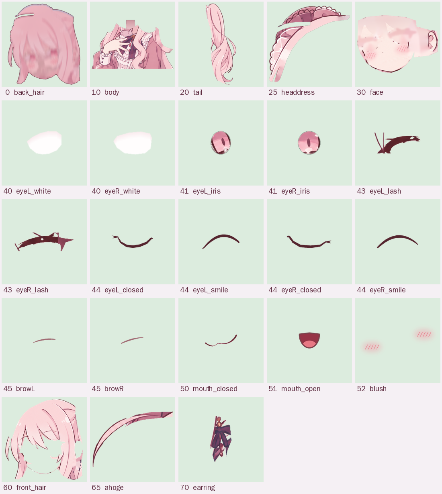
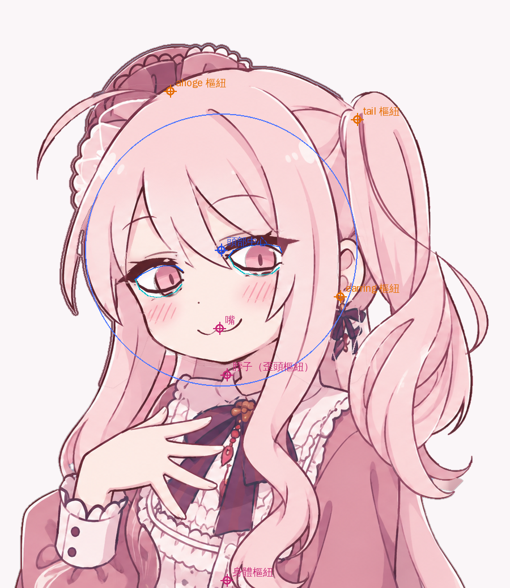

# 綁定說明（RIG）

主圖：`art/ref-main-flag.png`（1612×976）。只有一張平面圖，所以所有部位都是 `tools/segment.py` 切出來的，被遮住的地方用周圍的顏色補，閉眼、張嘴、眉毛、臉紅是另外畫的。

下面的座標都是**畫布座標**：畫布 900×1036，等於原圖的 `x=400..1300`、`y=-60..976`（上面多留 60px 給抬頭和呆毛）。原圖座標 = 畫布座標 + (400, −60)。

## 製作流程
1. `tools/cutout.py`：從四邊往內灌水，把接近旗子三種顏色（藍、粉、白）的區域當背景；被頭髮圍住的背景洞（耳朵下面、馬尾中間的白色、藍色小洞）另外指定。
2. `tools/segment.py`：用手畫的多邊形大致分區，再用顏色細分（皮膚的色相偏橘、頭髮偏粉紅，所以可以分開瀏海和臉）。
3. 每個部位輸出成 `src/assets/parts/<名稱>.png`（裁到最小外框），位置、層級、樞紐點寫進 `src/assets/rig.json`。
4. `tools/rig_sheet.py`：產生上面兩張圖。

## 部位表（由後往前）

| 層級 | 部位 | 範圍（畫布 x, y, 寬×高） | 樞紐 / 錨點 | 怎麼來的 |
|---:|---|---|---|---|
| 0 | `back_hair` 後髮 | 65, 71, 595×624 | 跟頭部 | 頭部輪廓外擴，用看得到的頭髮往下拉出髮絲紋理再壓暗＋深色描邊。轉頭時從另一邊露出來，當作頭髮的厚度 |
| 10 | `body` 身體 | 23, 557, 801×479 | 身體樞紐 (400, 1036) | 脖子以下全部（含手、垂到胸前的頭髮）。下巴底下補了一段脖子，馬尾底下補了衣服 |
| 20 | `tail` 側馬尾 | 597, 158, 269×706 | (630, 210) 馬尾根部 | 多邊形＋把自己的描邊一起帶走，底下的衣服另外補 |
| 25 | `headdress` 髮飾 | 122, 76, 362×342 | 跟頭部 | 頭頂的蕾絲頭飾，往頭髮底下多補 18px |
| 30 | `face` 臉 | 209, 327, 443×321 | 跟頭部 | 皮膚＋耳朵＋耳朵前的鬢角。眼睛、睫毛、嘴、眉毛和被瀏海蓋住的額頭都用附近的膚色補平；睫毛原本的位置加一點粉色當眼皮 |
| 40 | `eyeL_white` / `eyeR_white` 眼白 | 232, 461 / 397, 423 | 下眼緣 | 依眼睛開口多邊形重畫，上緣有睫毛的陰影 |
| 41 | `eyeL_iris` / `eyeR_iris` 瞳孔 | 268, 462 / 429, 426 | 中心 (296, 494) / (460, 458) | 原圖瞳孔，被睫毛擋住的上半部用瞳孔自己的顏色補完整 |
| 43 | `eyeL_lash` / `eyeR_lash` 上睫毛 | 204, 451 / 388, 403 | 眼睛開口上緣 | 原圖的深色睫毛帶（填滿中間較亮的部分，去掉穿過去的髮絲） |
| 44 | `eyeL_closed` / `eyeR_closed`、`eyeL_smile` / `eyeR_smile` 閉眼線、笑眼線 | 眼睛範圍 | 跟頭部 | 重畫：閉眼是沿著下眼緣的 ∪（外眼角有兩根小睫毛），笑眼是 ∩；中間粗兩端細，顏色和原圖睫毛一樣 |
| 45 | `browL` / `browR` 眉毛 | 242, 438 / 396, 399 | 自己的中心 | 原圖的眉毛幾乎被瀏海蓋住，所以重畫成細細的弧線 |
| 50 | `mouth_closed` 閉嘴 | 345, 559, 85×34 | 嘴 (387, 578) | 原圖的「ω」嘴 |
| 51 | `mouth_open` 張嘴 | 351, 569, 72×61 | 上緣 (387, 576) | 重畫：深紅色口腔＋舌頭，描邊和原圖同色 |
| 52 | `blush` 臉紅 | 242, 479, 258×106 | — | 重畫：粉色暈染＋斜線，害羞和鼓臉時才出現 |
| 60 | `front_hair` 瀏海與頭頂 | 70, 117, 585×573 | 跟頭部，下緣接回身體 | 頭部區域裡「不是皮膚」的部分；睫毛正上方被切斷的髮絲碎片去掉 |
| 65 | `ahoge` 呆毛 | 61, 151, 246×169 | (300, 160) 根部 | 整根（含跨過髮飾的根部），髮飾被蓋住的地方另外補 |
| 70 | `earring` 耳環 | 579, 517, 59×121 | (600, 522) 掛勾 | 深色緞帶和珠子；原本的位置用頭髮顏色補 |

眼睛開口（上緣＝睫毛下緣，下緣＝下眼緣），畫布座標：

- 左眼（畫面左邊）：上緣 (238,492)→(290,467)→(321,476)，下緣 (238,492)→(276,523)→(321,500)
- 右眼：上緣 (403,452)→(470,429)→(496,444)，下緣 (403,452)→(456,484)→(496,444)

其他樞紐：頭部中心 (390, 440)、頭部半徑 240、脖子（歪頭和身體帶動頭的點）(400, 660)、身體樞紐 (400, 1036)。

## 變形器（`src/model.ts`）
每個部位都是三角網格（格子大小 5～24px，依部位細節決定），頂點每一幀依參數重新計算，順序是：

1. **部位自己的變形**
   - 眼白：以下眼緣為底，依眼睛開合壓扁（開合 >1 會睜大）
   - 瞳孔：先依「瞳孔左右／上下」平移（靜止時放在眼睛正中間），再和眼白一起壓扁；用 stencil 裁在眼白裡，所以不會跑出眼眶
   - 睫毛：往下移到下眼緣；開合低於 0.2 左右時，原圖的睫毛淡出、換成畫好的閉眼線（∪），「眼睛 笑」則換成笑眼線（∩，^ ^）。眼白快閉上時兩端往中間收，眼角不會露白
   - 眉毛：上下移動＋左右對稱旋轉
   - 嘴：閉嘴／張嘴兩張圖交叉淡入，張嘴從上緣往下拉開，「嘴巴形狀」讓嘴角上揚或下垂
   - 臉：鼓臉頰時兩頰的頂點往外推
   - 頭髮：瀏海、後髮依高度橫向擺動；側馬尾和呆毛是兩節彎曲（第一節 `tail`/`ahoge` 隨距離線性彎，第二節 `tail2`/`ahoge2` 隨距離平方彎，所以髮尾會甩出 S 形）；耳環繞掛勾旋轉
2. **頭部轉動**：把頭當成球面，越靠近臉中央的頂點移動越多、邊緣越少，再加上每個部位的深度（`PART_CONF.depth`）：瀏海 +0.35（往兩側遞減到 −0.2，因為側邊頭髮其實在頭的側面）、五官 +0.1～0.18、臉 0、髮飾與馬尾 −0.3、後髮 −0.45。轉頭時前面的東西動得多、後面的動得少甚至反方向，看起來就有立體感。歪頭是繞脖子旋轉。
3. **身體**：越往上影響越大的旋轉（身體傾斜）、平移（身體左右）和往上抬（呼吸）。頭部整塊跟著脖子那一點走。瀏海和後髮的下緣用漸變權重接回身體，所以不會在脖子附近裂開。

## 已知限制（平面圖切圖的極限）
- 頭轉到最極端（±30° 同時加歪頭）時，髮飾左側和頭髮之間會露出一點補出來的顏色
- 耳環被甩開時，原本耳環的位置是補出來的，看得出比較糊
- 瀏海底下的額頭是用膚色補的，只有轉頭的邊緣看得到
