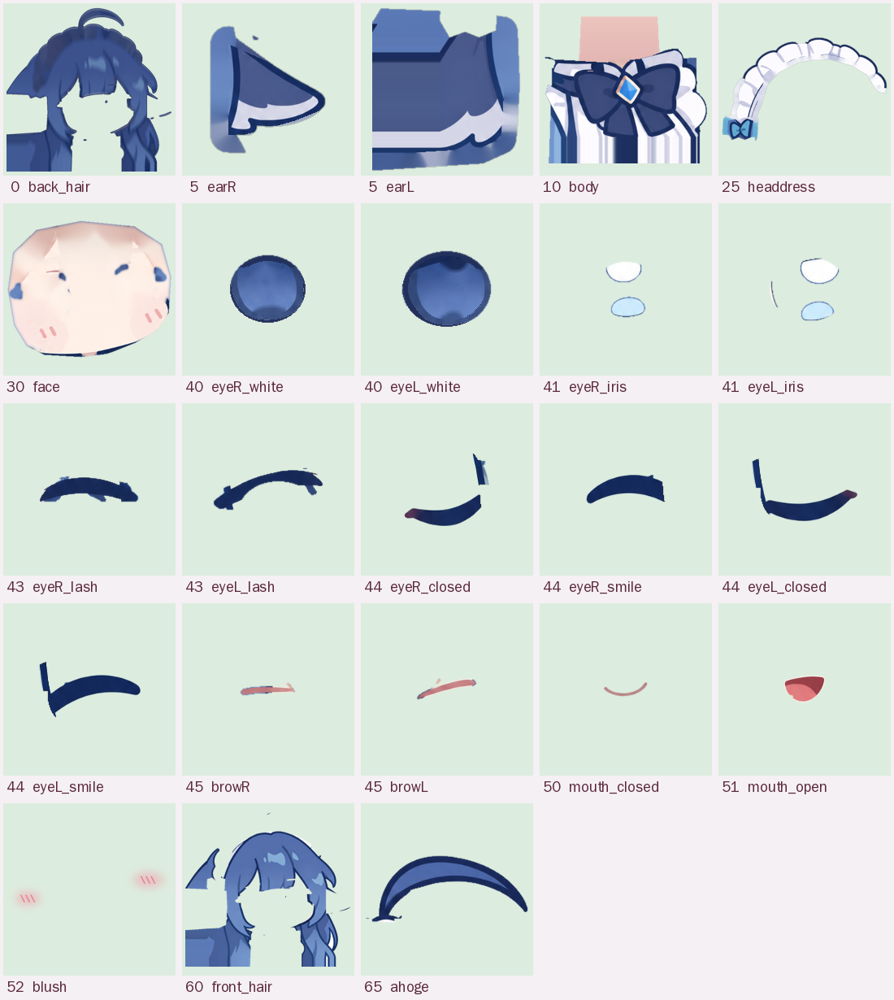

# 綁定說明（RIG）

有兩個角色：上半部是主角（粉紅雙馬尾），[後半部](#第二個角色垂耳女僕)是垂耳女僕。

## 主角：粉紅雙馬尾

主圖（2026-11 起）：`art/pink2/expression_01..12.png`，用生圖模型生的同一張圖、只換表情（綠背景、1254×1254、彼此對齊）。由 `tools/pink2_segment.py` 切：
- 綠幕去背；眼睛位置是手量的（腳本最上面 `EYES`），眼白取幾張不同視線的圖裡最亮的、剩下用白色補，瞳孔被睫毛蓋住的部分用周圍補
- 閉眼線直接取 `expression_10`、笑眼（^ ^）取 `expression_07`、張嘴取 `expression_11`、臉紅加強是 `expression_07` 比 `expression_01` 紅多少反推出來的，所以都是原畫的線條，不是另外畫的
- 頭髮和皮膚幾乎同色，臉是用「輪廓線圍起來、色相偏橘」的區塊找出來的；如果之後有 `art/pink2/no_bangs.png` 等三張頭髮圖，可以切得更準
- 新部位 `eyeL_lower`／`eyeR_lower`（下眼線），畫在瞳孔上面、閉眼時跟眼白一起淡出
- 畫布 890×1244 = 原圖 `x=180..1070`、`y=50..1254`，下面多補 40px（`bleed.bottom`，放在畫面外）；畫面上的長寬比由 `main.ts` 依 `rig.json` 設定

以下是舊版主圖 `art/ref-main-flag.png` 的說明（舊腳本 `tools/cutout.py`、`tools/segment.py` 仍保留）：

下面的座標都是**畫布座標**：畫布 900×1036，等於原圖的 `x=400..1300`、`y=-60..976`（上面多留 60px 給抬頭和呆毛）。原圖座標 = 畫布座標 + (400, −60)。

### 製作流程
1. `tools/cutout.py`：從四邊往內灌水，把接近旗子三種顏色（藍、粉、白）的區域當背景；被頭髮圍住的背景洞（耳朵下面、馬尾中間的白色、藍色小洞）另外指定。
2. `tools/segment.py`：用手畫的多邊形大致分區，再用顏色細分（皮膚的色相偏橘、頭髮偏粉紅，所以可以分開瀏海和臉）。
3. 每個部位輸出成 `src/chars/pink/parts/<名稱>.png`（裁到最小外框），位置、層級、樞紐點寫進 `src/chars/pink/rig.json`。
4. `tools/rig_sheet.py`：產生上面兩張圖。

### 部位表（由後往前）

| 層級 | 部位 | 範圍（畫布 x, y, 寬×高） | 樞紐 / 錨點 | 怎麼來的 |
|---:|---|---|---|---|
| 0 | `back_hair` 後髮 | 65, 71, 595×624 | 跟頭部 | 頭部輪廓外擴，用看得到的頭髮往下拉出髮絲紋理再壓暗＋深色描邊。轉頭時從另一邊露出來，當作頭髮的厚度 |
| 10 | `body` 身體 | 23, 557, 801×479 | 身體樞紐 (400, 1036) | 脖子以下全部（含手、垂到胸前的頭髮）。下巴底下補了一段脖子，馬尾底下補了衣服 |
| 20 | `tail` 側馬尾 | 597, 158, 269×706 | (630, 210) 馬尾根部 | 多邊形＋把自己的描邊一起帶走，底下的衣服另外補 |
| 25 | `headdress` 髮飾 | 122, 76, 362×342 | 跟頭部 | 頭頂的蕾絲頭飾，往頭髮底下多補 18px |
| 30 | `face` 臉 | 209, 327, 443×321 | 跟頭部 | 皮膚＋耳朵＋耳朵前的鬢角。眼睛、睫毛、嘴、眉毛和被瀏海蓋住的額頭都用附近的膚色補平；睫毛原本的位置加一點粉色當眼皮 |
| 40 | `eyeL_white` / `eyeR_white` 眼白 | 232, 461 / 397, 423 | 下眼緣 | 依眼睛開口多邊形重畫，上緣有睫毛的陰影 |
| 41 | `eyeL_iris` / `eyeR_iris` 瞳孔 | 268, 462 / 429, 426 | 中心 (296, 494) / (460, 458) | 原圖瞳孔，被睫毛擋住的上半部用瞳孔自己的顏色補完整 |
| 43 | `eyeL_lash` / `eyeR_lash` 上睫毛 | 204, 451 / 388, 403 | 眼睛開口上緣 | 原圖的深色睫毛帶（填滿中間較亮的部分，去掉穿過去的髮絲） |
| 44 | `eyeL_closed` / `eyeR_closed`、`eyeL_smile` / `eyeR_smile` 閉眼線、笑眼線 | 眼睛範圍 | 跟頭部 | 重畫：閉眼是沿著下眼緣的 ∪（外眼角有兩根小睫毛），笑眼是 ∩；中間粗兩端細，顏色和原圖睫毛一樣 |
| 45 | `browL` / `browR` 眉毛 | 242, 438 / 396, 399 | 自己的中心 | 原圖的眉毛幾乎被瀏海蓋住，所以重畫成細細的弧線 |
| 50 | `mouth_closed` 閉嘴 | 345, 559, 85×34 | 嘴 (387, 578) | 原圖的「ω」嘴 |
| 51 | `mouth_open` 張嘴 | 351, 569, 72×61 | 上緣 (387, 576) | 重畫：深紅色口腔＋舌頭，描邊和原圖同色 |
| 52 | `blush` 臉紅 | 242, 479, 258×106 | — | 重畫：粉色暈染＋斜線，害羞和鼓臉時才出現 |
| 60 | `front_hair` 瀏海與頭頂 | 70, 117, 585×573 | 跟頭部，下緣接回身體 | 頭部區域裡「不是皮膚」的部分；睫毛正上方被切斷的髮絲碎片去掉 |
| 65 | `ahoge` 呆毛 | 61, 151, 246×169 | (300, 160) 根部 | 整根（含跨過髮飾的根部），髮飾被蓋住的地方另外補 |
| 70 | `earring` 耳環 | 579, 517, 59×121 | (600, 522) 掛勾 | 深色緞帶和珠子；原本的位置用頭髮顏色補 |

眼睛開口（上緣＝睫毛下緣，下緣＝下眼緣），畫布座標：

- 左眼（畫面左邊）：上緣 (238,492)→(290,467)→(321,476)，下緣 (238,492)→(276,523)→(321,500)
- 右眼：上緣 (403,452)→(470,429)→(496,444)，下緣 (403,452)→(456,484)→(496,444)

其他樞紐：頭部中心 (390, 440)、頭部半徑 240、脖子（歪頭和身體帶動頭的點）(400, 660)、身體樞紐 (400, 1036)。

### 變形器（`src/model.ts`）
每個部位都是三角網格（格子大小 5～24px，依部位細節決定），頂點每一幀依參數重新計算，順序是：

1. **部位自己的變形**
   - 眼白：以下眼緣為底，依眼睛開合壓扁（開合 >1 會睜大）
   - 瞳孔：先依「瞳孔左右／上下」平移（靜止時放在眼睛正中間），再和眼白一起壓扁；用 stencil 裁在眼白裡，所以不會跑出眼眶
   - 睫毛：往下移到下眼緣；開合低於 0.2 左右時，原圖的睫毛淡出、換成畫好的閉眼線（∪），「眼睛 笑」則換成笑眼線（∩，^ ^）。眼白快閉上時兩端往中間收，眼角不會露白
   - 眉毛：上下移動＋左右對稱旋轉
   - 嘴：閉嘴／張嘴兩張圖交叉淡入，張嘴從上緣往下拉開，「嘴巴形狀」讓嘴角上揚或下垂
   - 臉：鼓臉頰時兩頰的頂點往外推
   - 頭髮：瀏海、後髮依高度橫向擺動；側馬尾和呆毛是兩節彎曲（第一節 `tail`/`ahoge` 隨距離線性彎，第二節 `tail2`/`ahoge2` 隨距離平方彎，所以髮尾會甩出 S 形）；耳環繞掛勾旋轉
2. **頭部轉動**：把頭當成球面，越靠近臉中央的頂點移動越多、邊緣越少，再加上每個部位的深度（`src/chars/pink/index.ts` 的 `conf.parts[...].depth`）：瀏海 +0.35（往兩側遞減到 −0.2，因為側邊頭髮其實在頭的側面）、五官 +0.1～0.18、臉 0、髮飾與馬尾 −0.3、後髮 −0.45。轉頭時前面的東西動得多、後面的動得少甚至反方向，看起來就有立體感。歪頭是繞脖子旋轉。
3. **身體**：越往上影響越大的旋轉（身體傾斜）、平移（身體左右）和往上抬（呼吸）。頭部整塊跟著脖子那一點走。瀏海和後髮的下緣用漸變權重接回身體，所以不會在脖子附近裂開。

### 已知限制（平面圖切圖的極限）
- 頭轉到最極端（±30° 同時加歪頭）時，髮飾左側和頭髮之間會露出一點補出來的顏色
- 耳環被甩開時，原本耳環的位置是補出來的，看得出比較糊
- 瀏海底下的額頭是用膚色補的，只有轉頭的邊緣看得到

## 第二個角色：垂耳女僕

主圖：`art/ref-maid.jpg`（988×988，白底，右上角有一個想法泡泡）。Q 版、只有上半身，而且**右邊和下面被畫面切掉**。

### 製作流程
1. `tools/maid_cutout.py`：白底從四邊往內灌水，留下最大的一塊（想法泡泡是分開的，會被丟掉）；邊緣的半透明用「深藍描邊混白色」反推 alpha，所以不會有白邊。
2. `tools/maid_segment.py`：
   - 切到的右邊補 96px、下面補 40px（重複最後一排像素，頭頂那段沿著頭的弧度往下收、畫上描邊），再**整張左右翻轉**，讓她從畫面左下角探頭。補出來的那一圈放在畫面外面，轉頭、歪頭、身體晃的時候才不會露出切口
   - 用多邊形大致分區（呆毛、頭飾、蝴蝶結、兩隻耳朵、臉、領子），再用顏色細分：膚色、頭髮藍、深藍描邊、白色
   - 畫布＝原圖（補邊後）`x=300..1084`、`y=250..1028`，翻轉後畫布座標 x = 1083 − 原圖 x、y = 原圖 y − 250

### 部位表（由後往前，畫布座標）

| 層級 | 部位 | 範圍（x, y, 寬×高） | 樞紐 / 錨點 | 怎麼來的 |
|---:|---|---|---|---|
| 0 | `back_hair` | 0, 32, 763×746 | 跟頭部 | 整顆頭（頭髮＋頭飾）外擴，用頭髮顏色往下拉出紋理再壓暗＋深色描邊 |
| 5 | `earR` | 612, 400, 147×162 | (637, 472) | 垂耳，下緣白色的毛一起切；被頭髮蓋住的根部往裡補 |
| 5 | `earL` | 0, 398, 215×239 | (181, 462) | 垂耳（原圖右邊那隻，被切到畫面外，翻轉後在左邊），被頭髮蓋住的根部往裡補 |
| 10 | `body` | 280, 547, 261×231 | 身體 | 領子、蝴蝶結、寶石；下巴底下補一段脖子 |
| 25 | `headdress` | 78, 106, 541×342 | 跟頭部 | 女僕頭飾的荷葉邊＋藍色小蝴蝶結；和頭髮共用的描邊歸頭髮，往頭髮底下補 16px |
| 30 | `face` | 216, 313, 373×312 | 跟頭部 | 皮膚。眼睛、眼皮、眉毛的位置和被瀏海蓋住的額頭用附近的膚色補；眼皮兩端壓在頭髮上的地方改補頭髮色 |
| 40 | `eyeR_white` | 444, 424, 107×101 | 跟頭部 | 同上 |
| 40 | `eyeL_white` | 248, 433, 121×111 | 跟頭部 | 整顆眼睛（深藍外框＋藍色），亮點挖掉補成藍色；被眼皮蓋住的外框上緣畫回來 |
| 41 | `eyeR_iris` | 475, 431, 55×84 | (497, 474) | 同上 |
| 41 | `eyeL_iris` | 292, 440, 62×95 | (308, 488) | 只有眼睛裡的白色和淺藍色亮點，看別的方向時亮點在眼睛裡滑動（用 stencil 裁在眼睛裡） |
| 43 | `eyeR_lash` | 442, 405, 125×36 | 跟頭部 | 同上 |
| 43 | `eyeL_lash` | 224, 413, 144×66 | 跟頭部 | 原圖的粗眼皮線（穿過去的髮絲描邊去掉） |
| 44 | `eyeR_closed` | 443, 473, 124×30 | 跟頭部 | 同上 |
| 44 | `eyeR_smile` | 443, 469, 124×31 | 跟頭部 | 同上 |
| 44 | `eyeL_closed` | 225, 490, 143×36 | 跟頭部 | 重畫：閉眼的淺 ∪ 線，和眼皮一樣粗、一樣斜 |
| 44 | `eyeL_smile` | 225, 491, 143×35 | 跟頭部 | 重畫：笑眼的 ∩ 線 |
| 45 | `browR` | 460, 379, 30×13 | 跟頭部 | 同上 |
| 45 | `browL` | 303, 393, 36×21 | 跟頭部 | 原圖的粉色短眉 |
| 51 | `mouth_open` | 390, 554, 35×30 | (407, 561) | 重畫：原圖沒有嘴巴，說話時才出現的小嘴（深紅＋舌頭＋深藍描邊） |
| 52 | `blush` | 226, 496, 367×90 | 跟頭部 | 重畫：粉色暈染＋斜線，害羞和鼓臉時才出現 |
| 60 | `front_hair` | 0, 76, 758×702 | 跟頭部 | 頭部裡不是皮膚、頭飾、耳朵、呆毛的部分，包含垂到胸前的長髮 |
| 65 | `ahoge` | 318, 36, 216×96 | (335, 126) | 整根呆毛，根部插在頭飾後面 |

其他樞紐：頭部中心 (393, 440)、頭部半徑 260、脖子 (393, 618)、身體樞紐 (393, 778)。

### 和主角不一樣的地方
- **眼睛**：Q 版的眼睛沒有眼白，整顆是深藍的。所以「眼白」層是整顆眼睛，「瞳孔」層只有亮點：看左看右時亮點在眼睛裡滑動（`rig.json` 的 `eyes.*.move` 是可以滑多遠）。眨眼時眼睛往下眼緣壓扁、眼皮線往下蓋，快閉上時換成畫好的閉眼線
- **沒有嘴巴**：原圖沒畫嘴，所以平常不畫，說話、對嘴、打瞌睡時才出現小小的張嘴
- **垂耳**：新的參數 `earL`／`earR`，繞耳根擺，越靠近耳尖擺越多；物理是軟軟的彈簧擺，被戳、驚醒時會抖一下
- **深度**：瀏海 +0.3（兩側遞減到 −0.15）、五官 +0.1～0.16、臉 0、頭飾 −0.15、耳朵 −0.25、後髮 −0.4；垂到胸前的長髮在畫布 y 600～730 從跟頭走漸變成跟身體走
- **個性**（`src/chars/maid/index.ts` 的 `persona`）：頭追視線比較慢（0.6 秒）、眨眼比較少、比較容易睡著（主角的 0.7 倍時間）、歪頭角度比較小（`tune.roll`）

### 已知限制
- 眼睛閉起來時，原本眼皮兩端壓在頭髮上的地方是補出來的頭髮色，近看比較糊
- 被切掉的右半邊（翻轉後是左邊）只能用重複像素補，所以她只能貼在畫面邊緣，不能整個人走到畫面中間
- 只有一張圖，所以也沒有其他表情可以參考；閉眼、笑眼、嘴巴都是照原圖的線條粗細和顏色另外畫的
